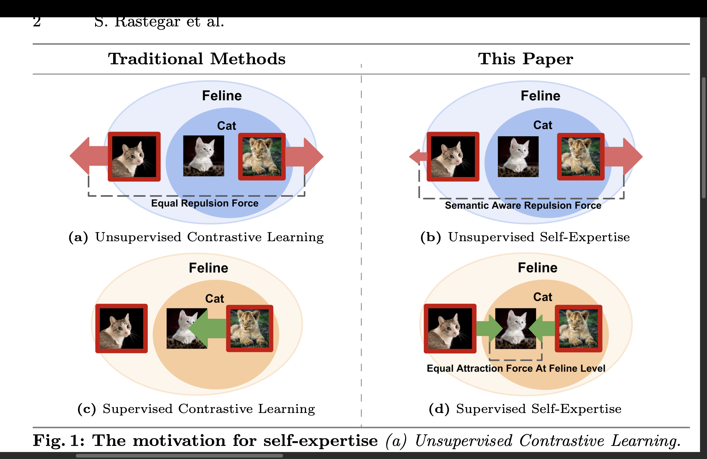

# SelEx: Self-Expertise in Fine-Grained Generalized Category Discovery


<p align="center">
    <a href="https://www.arxiv.org/abs/2408.14371"></a>
    <a href="https://www.arxiv.org/abs/2408.14371"></a>
</p>

<p align="center">
	SelEx: Self-Expertise in Fine-Grained Generalized Category Discovery (ECCV 2024)<br>
  By
  <a href="https://sarahrastegar.github.io/">Sarah Rastegar</a>, 
  <a href="https://smsd75.github.io/">Mohammadreza Salehi</a>, 
  <a href="https://yukimasano.github.io/">Yuki Asano</a>, 
  <a href="https://hazeldoughty.github.io/">Hazel Doughty</a>, and 
  <a href="https://www.ceessnoek.info/">Cees Snoek</a>.
</p>



## Update (November 2026): fix for issue #11

[Issue #11](https://github.com/SarahRastegar/SelEx/issues/11) reported a label leak in the hierarchy: the semi-supervised k-means returns its labels with the labelled images first, but the code used them in data-loader order. On datasets stored in class order, this mismatch passes class information into the pseudo-labels of the unlabelled images. This version fixes it in `methods/contrastive_training/contrastive_training.py`:

- the k-means labels are put back in loader order (`to_loader_order`).

With this fix alone the coarse levels lowered accuracy, so they also change:

- coarse level *i* groups all level-0 prototypes (known and novel together) with k-means, and every image takes the group of its level-0 cluster;
- level *i* enters the loss at epoch 10·*i*;
- a guard stops an empty cluster from producing NaN.

The per-dataset settings in `config.py` changed with the fix (table below). Results with this code, `Train ACC Unlabelled_v2` All / Old / New of the last checkpoint, mean ± standard deviation over seeds 1-3 (one H100 each):

| Dataset | DINO | DINOv2 |
|---|---|---|
| CUB | 71.7 ± 0.5 / 75.0 ± 0.3 / 70.0 ± 0.6 | 83.5 ± 0.6 / 85.6 ± 0.4 / 82.5 ± 0.8 |
| Stanford Cars | 58.9 ± 0.6 / 77.9 ± 1.9 / 49.7 ± 1.3 | 79.1 ± 0.6 / 93.4 ± 0.2 / 72.2 ± 0.9 |
| FGVC-Aircraft | 58.6 ± 2.5 / 67.0 ± 0.5 / 54.4 ± 3.6 | 77.2 ± 0.2 / 82.5 ± 1.1 / 74.6 ± 0.4 |
| Oxford Pets | 92.4 ± 0.4 / 91.5 ± 0.2 / 92.9 ± 0.5 | 94.8 ± 0.1 / 95.4 ± 0.5 / 94.5 ± 0.1 |
| Herbarium-19 | 40.6 ± 0.6 / 54.8 ± 0.5 / 32.9 ± 0.7 | 50.9 ± 0.5 / 67.6 ± 0.6 / 41.9 ± 0.6 |
| CIFAR-10 | 96.5 ± 0.4 / 96.6 ± 0.1 / 96.5 ± 0.5 | 98.8 ± 0.0 / 98.0 ± 0.0 / 99.2 ± 0.1 |
| CIFAR-100 | 81.9 ± 0.6 / 82.9 ± 0.7 / 79.9 ± 0.6 | 90.7 ± 0.3 / 91.2 ± 0.1 / 89.6 ± 1.0 |
| ImageNet-100 | 82.1 ± 0.5 / 92.2 ± 0.0 / 77.0 ± 0.8 | 86.1 ± 0.5 / 94.8 ± 0.2 / 81.8 ± 0.7 |

Settings behind these results, the same for DINO and DINOv2. Everything else is unchanged: batch size 128, lr 0.1, weight decay 1e-4, `sup_con_weight` 0.35, and `unbalanced` for Herbarium-19.

| Dataset | `unsupervised_smoothing` | `temperature` | `grad_from_block` | `epochs` |
|---|---|---|---|---|
| CUB, Oxford Pets | 0.75 | 0.25 | 10 | 50 |
| Stanford Cars, FGVC-Aircraft, Herbarium-19 | 0.75 | 0.5 | 9 | 50 |
| CIFAR-10, CIFAR-100, ImageNet-100 | 0.5 | 0.15 | 10 | 20 |

Our runs used `--num_workers 4` (8 for Herbarium-19 and CIFAR, 12 for ImageNet-100); other values change the augmentation draws, so a single run can differ within seed noise.


## Dependencies

```
conda env create -f environment.yml    # Python 3.12 + requirements.txt
conda activate selex
```
or `pip install -r requirements.txt` in a Python 3.12 environment. The PyPI `torch` wheels are built for CUDA 13.0 (NVIDIA driver >= 580, GPU compute capability >= 7.5); otherwise (e.g. V100), install `torch` and `torchvision` from `https://download.pytorch.org/whl/cu126` first.

### kmeans_pytorch Installation
Since our work relies heavily on [kmeans_pytorch](https://github.com/subhadarship/kmeans_pytorch) for cluster assignments, you need to ensure that it is correctly imported to reproduce the results from the paper. `requirements.txt` installs it from GitHub (commit `f7f36bd`); the PyPI release (0.3) lacks arguments SelEx uses. Without GitHub access, copy the `kmeans_pytorch` package folder of a clone (the one containing `__init__.py`) into the repository root.

**Note:** While using `scikit-learn`'s KMeans provides improvements, the results in the paper have been reported using `kmeans_pytorch`.

## Config

Set paths to datasets, pre-trained models and desired log directories in ```config.py```. Relative paths are resolved from `methods/contrastive_training`, where the scripts are run.

- `dino_v1` selects the backbone for training and evaluation: `True` for DINO ViT-B/16 (`dino_vitbase16_pretrain.pth`, the official backbone weights), `False` for DINOv2 ViT-B/14 with registers (`dinov2_vitb14_reg4_pretrain.pth`).
- `car_root`: Stanford Cars now uses the SimGCD version.
- `dataset_configs` holds the per-dataset settings (see below).

Set ```SAVE_DIR``` (logfile destination) and ```PYTHON``` (path to python interpreter) in ```bash_scripts``` scripts.

## Datasets

We use fine-grained benchmarks in this paper, including:                                                                                                                    
                                                                                                                                                                  
* [The Semantic Shift Benchmark (SSB)](https://github.com/sgvaze/osr_closed_set_all_you_need#ssb) and [Herbarium19](https://www.kaggle.com/c/herbarium-2019-fgvc6)

We also use generic object recognition datasets, including:

* [CIFAR-10/100](https://pytorch.org/vision/stable/datasets.html) and [ImageNet](https://image-net.org/download.php)


## Scripts

**Train representation**:
To run the code with the hyperparameters of the results above, execute the following command:

```
cd methods/contrastive_training
python contrastive_training.py --dataset_name cub
```
This script will automatically train the representations, extract features, and fit the semi-supervised KMeans algorithm. It also provides final evaluations on both the best checkpoint and the final checkpoint.

**Dataset Hyperparameter Specifics**: `--unsupervised_smoothing`, `--temperature`, `--grad_from_block`, `--epochs` and `--unbalanced` are set per dataset from `dataset_configs` in `config.py` (values in the settings table at the top; the same for DINO and DINOv2). A value passed on the command line overrides the table. Set `dino_v1 = False` in `config.py` for DINOv2.

## Evaluation
In the `Final Reports` section at the end, please note that only the evaluations reported for:
```
Reports for the best checkpoint:
Reports for the last checkpoint:
```
are the evaluations performed at test time to evaluate the checkpoints. Additionally, please note that `Train ACC Unlabelled_v2` is the metric reported by our work and prior studies.

## <a name="cite"/> :clipboard: Citation

If you use this code in your research, please consider citing our paper:

```
@inproceedings{RastegarECCV2024,
title = {SelEx: Self-Expertise in Fine-Grained Generalized Category Discovery},
author = {Sarah Rastegar and Mohammadreza Salehi and Yuki M Asano and Hazel Doughty and Cees G M Snoek},
year = {2024},
booktitle = {European Conference on Computer Vision},
}
```

## Acknowledgements

The codebase is mainly built on the repo of https://github.com/sgvaze/generalized-category-discovery. 

## Further Resources
If you found our code helpful and are interested in exploring more, also check out our **NeurIPS 2023** paper *Learn to Categorize or Categorize to Learn? Self-Coding for Generalized Category Discovery* <a href="https://arxiv.org/abs/2310.19776"></a> <a href="https://github.com/SarahRastegar/InfoSieve"></a>.

